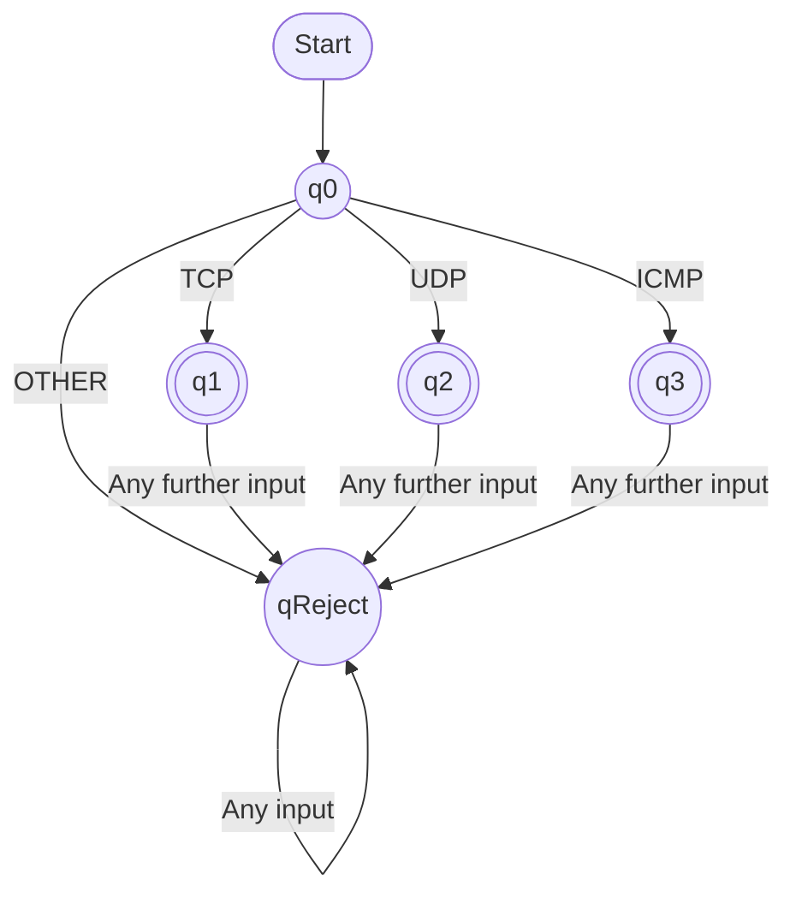

# NetGuard
## Network Packet Validation & Classification System

NetGuard is a web-based application developed to validate, classify, and monitor network packet records using regular expressions, validation rules, and a Deterministic Finite Automaton (DFA).

The application supports TCP, UDP, and ICMP protocol classification. It validates IP addresses and port numbers, identifies invalid packets, and stores packet records in MongoDB.

## 1. Project Objectives

- Validate source and destination IPv4 addresses.
- Validate TCP and UDP port numbers.
- Classify network protocols using a finite automaton.
- Identify unsupported protocols.
- Display valid and invalid packet records.
- Show validation errors for invalid packets.
- Store and retrieve packet records using MongoDB.
- Provide a searchable packet dashboard.

## 2. Technologies Used

| Technology | Purpose |
|---|---|
| React.js | Frontend user interface |
| Node.js | JavaScript runtime |
| Express.js | Backend API |
| MongoDB | Database |
| Mongoose | MongoDB object modelling |
| JavaScript | Application logic |
| Regular Expressions | IP address and input validation |
| DFA | Protocol classification |

## 3. System Architecture

The application follows a client-server architecture.

1. The user enters packet information in the React frontend.
2. React performs initial input validation.
3. The packet details are sent to the Express backend.
4. The backend independently validates the IP addresses and port numbers.
5. The DFA classifies the protocol.
6. The backend determines the final validation status.
7. The packet record is stored in MongoDB.
8. The frontend retrieves and displays the packet records.

## 4. Packet Validation Rules

### IPv4 Address Validation

An IPv4 address must contain four numeric octets separated by dots.

Example:

- Valid: `192.168.1.10`
- Invalid: `999.168.1.10`
- Invalid: `192.168.1`

Each octet must be within the range 0–255.

### Port Number Validation

TCP and UDP port numbers must:
- Contain numeric digits only.
- Be within the range 0–65535.

Examples:

- Valid: `443`
- Valid: `3000`
- Invalid: `70000`
- Invalid: `-1`

### ICMP Validation

ICMP does not use TCP or UDP port numbers. Therefore, both port fields are displayed as `N/A`.

## 5. DFA-Based Protocol Classification

The application uses a Deterministic Finite Automaton to classify protocol inputs.

**Input Alphabet:**

Σ = {TCP, UDP, ICMP, OTHER}

**States:**

Q = {q0, q1, q2, q3, qReject}

- q0 – Initial state
- q1 – TCP accepting state
- q2 – UDP accepting state
- q3 – ICMP accepting state
- qReject – Rejection state

**Initial State:** q0

**Final States:** F = {q1, q2, q3}

### State Transition Diagram



### State Transition Table

| Current State | TCP | UDP | ICMP | OTHER |
|---|---|---|---|---|
| q0 | q1 | q2 | q3 | qReject |
| q1 | qReject | qReject | qReject | qReject |
| q2 | qReject | qReject | qReject | qReject |
| q3 | qReject | qReject | qReject | qReject |
| qReject | qReject | qReject | qReject | qReject |

The DFA processes one protocol token at a time. The IP addresses and port numbers are validated separately using regular expressions and validation rules.

## 6. Application Features

- Add network packet records.
- Validate source and destination IP addresses.
- Validate source and destination port numbers.
- Classify TCP, UDP, and ICMP protocols.
- Reject unsupported protocols.
- Display DFA states.
- Identify valid and invalid packets.
- Display validation error messages.
- Search packet records.
- View total, valid, and invalid packet counts.
- Store packet records in MongoDB.
- Retrieve saved records after refreshing the application.

## 7. Sample Test Cases

| Test Input | Expected Classification | Expected Status |
|---|---|---|
| TCP with valid IPs and ports | TCP (q1) | Valid |
| UDP with valid IPs and ports | UDP (q2) | Valid |
| ICMP with valid IPs | ICMP (q3) | Valid |
| Invalid source IP | TCP (q1) | Invalid |
| Invalid destination IP | TCP (q1) | Invalid |
| Invalid source port | TCP (q1) | Invalid |
| Invalid destination port | UDP (q2) | Invalid |
| Unsupported HTTP protocol | Unknown (qReject) | Invalid |

## 8. Sample Output

**Valid TCP Packet**

- Source IP: 192.168.1.15
- Destination IP: 192.168.1.25
- Protocol: TCP
- Source Port: 5050
- Destination Port: 443
- Classification: TCP
- DFA State: q1
- Status: Valid

**Invalid IP Packet**

- Source IP: 999.168.1.15
- Destination IP: 192.168.1.25
- Protocol: TCP
- Classification: TCP
- DFA State: q1
- Status: Invalid
- Validation Error: Invalid source IP address.

**Unsupported Protocol**

- Protocol: HTTP
- Classification: Unknown
- DFA State: qReject
- Status: Invalid
- Validation Error: Unsupported network protocol.

## 9. Database Structure

Database Name: `netguard`

Collection Name: `packets`

Each packet record contains:

- sourceIP
- destinationIP
- protocol
- sourcePort
- destinationPort
- classification
- dfaState
- status
- validationErrors
- createdAt
- updatedAt

## 10. API Endpoints

| Method | Endpoint | Purpose |
|---|---|---|
| GET | `/` | Check backend status |
| POST | `/api/packets` | Validate and save a packet |
| GET | `/api/packets` | Retrieve all packet records |

## 11. Project Setup and Execution

### Prerequisites

- Node.js
- MongoDB Atlas account or MongoDB instance
- Visual Studio Code
- Web browser

### Backend Setup

Open a terminal:

```bash
cd server
npm install
```

Create a `.env` file inside the server folder and add your MongoDB connection string:

```env
MONGO_URI=your_mongodb_connection_string
```

Start the backend:

```bash
node server.js
```

The backend runs on:

`http://localhost:5000`

### Frontend Setup

Open another terminal:

```bash
cd client
npm install
```

Start the React application:

```bash
npm run dev
```

Open the application:

`http://localhost:5173`

Keep both frontend and backend servers running while using the application.

## 12. Conclusion

NetGuard demonstrates how regular expressions, input validation, finite automata, and database connectivity can be combined to build a network packet validation and classification system.

The application successfully classifies supported protocols, detects invalid packet information, displays validation errors, and stores packet records in MongoDB.